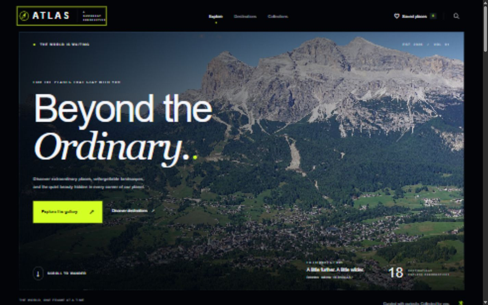
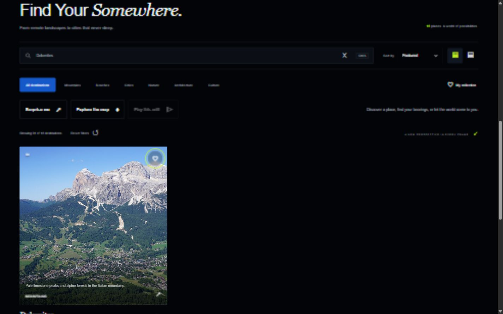
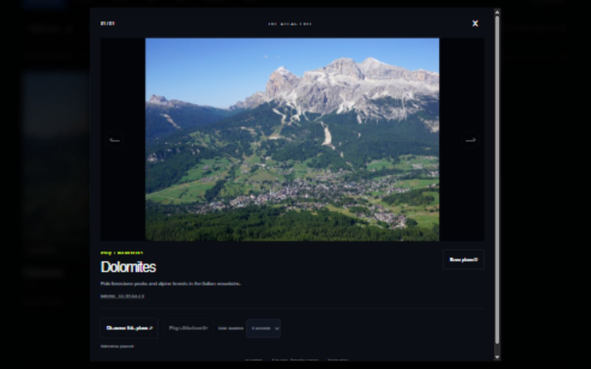
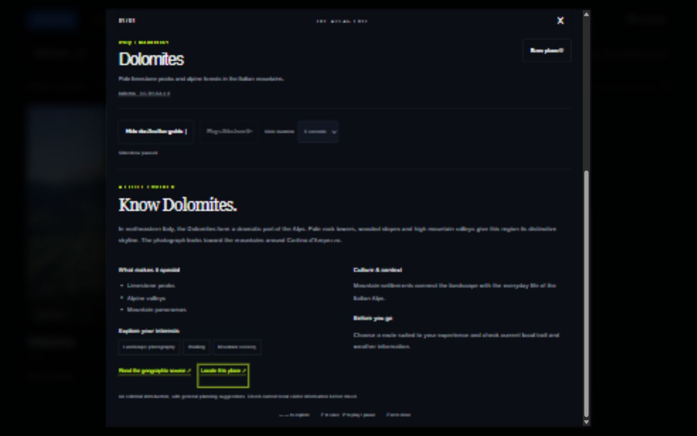

# ATLAS — Beyond the Ordinary

A build-free, interactive travel photography gallery for Frontend Design and Testing. Eighteen destinations across five continents, an editorial dark interface, and real mouse and keyboard interactions. Built with semantic HTML5, CSS3 and vanilla JavaScript; no runtime packages, framework, account, API key, or build step.

## Run locally

From this project's directory in PowerShell:

```powershell
python -m http.server 8000 --bind 127.0.0.1
```

Open [ATLAS locally](http://127.0.0.1:8000). Stop the server with Ctrl+C. Python 3 is the only server prerequisite. The application itself needs a modern browser with JavaScript and native `<dialog>` support. Opening `index.html` directly also loads the classic scripts, but HTTP provides consistent storage behavior. Internet access is required for photographs; local interface, metadata, filtering and fallback artwork remain available without it.

## Features

- 18 verified Wikimedia Commons photographs, complete author/license links, five continents, six categories.
- Live destination/country/category/keyword search, combined category and favorites filters, Featured/A–Z/Z–A sorting.
- Large and compact desktop grids; responsive two-column phone gallery, mobile navigation.
- Save places in validated localStorage; live counter, cross-tab updates, useful empty states.
- Native modal lightbox with ordered navigation, credit, image-loading feedback, favorite toggle, focus trap and restoration.
- Detailed destination guides for all 18 places: original sourced overviews, highlights, activities, culture/context and general planning tips.
- An interactive OpenStreetMap view with filtered destination choices, representative pins, pan/zoom and larger-map links. The remote embed loads on demand.
- Two/three-place comparison with selection chips, a three-place limit, and a separate accessible comparison dialog. Selections survive gallery filtering and are session-only.
- **Surprise me** chooses from the eligible edit without immediately repeating a place when alternatives exist.
- Explicitly started photography slideshow, 3/5/8-second durations, automatic looping, pause/resume and the P shortcut. It pauses on manual navigation, guide opening, image failure, closing or backgrounding the tab.
- Lazy thumbnails, asynchronous decoding, stable image ratios, graceful local error image, reduced-motion rules.
- Native button keyboard activation, visible focus rings, skip link and live result announcements.

## Screenshots


Editorial hero, branding and primary navigation.


Live search narrows the edit to the destination.


Native modal viewer with image credit, saving and navigation controls.


Overview, highlights, interests, culture, planning note and source links.

## Keyboard reference

| Key | Behavior |
| --- | --- |
| Tab / Shift+Tab | Traverse controls; stay inside an open dialog |
| Enter / Space | Activate a focused button, including photo and heart buttons |
| Ctrl+K / Cmd+K | Focus gallery search, outside editable controls |
| ← / → | Previous / next image while the lightbox is open |
| F | Toggle selected image's favorite in the lightbox |
| P | Play/pause the slideshow in the lightbox, outside editable controls |
| Escape | Close lightbox or expanded mobile navigation |

Manual navigation stops at the first and last photograph; automatic slideshow playback loops. The dialog snapshots the filtered order when opened; changing saved status does not remove the photo being viewed. Guides opened from comparison use the comparison's selected order, including places hidden by gallery filters. Favorites persist; search, sort, layout and comparison reset on reload. Shortcuts ignore editable fields and modified keys where relevant.

## Structure

```text
index.html                  Semantic page and native dialog
css/styles.css              Tokens, layouts, states and media queries
js/data.js                  Destination, photograph, guide and coordinate records
js/logic.js                 Selection, storage parsing, random/comparison/map helpers
js/app.js                   State, rendering, events and dialog lifecycle
assets/                     Original compass and image-error SVG artwork
docs/                       Report, plan, results, guide and image credits
tests/logic.test.cjs         Dependency-free Node tests
tests/verify_sources.py      Optional remote source/credit verification
tests/enrich_guides.py       Optional guide/coordinate source refresh
tests/manual-test-checklist.md
```

## Testing

Node.js 18 or newer is required only for automated tests:

```powershell
node --test tests/logic.test.cjs
node --check js/app.js
node --check js/logic.js
node --check js/data.js
```

To refresh live source metadata and verify all remote URLs, run `python tests/verify_sources.py` with internet access. This **rewrites** `js/data.js` and `docs/IMAGE_CREDITS.md`, preserving existing guide fields. `python tests/enrich_guides.py` verifies geographic source introductions/coordinates and rewrites guide fields and `docs/DESTINATION_SOURCES.md`, preserving photography metadata. Review changes before accepting them. Both use only Python's standard library. Wikimedia may rate-limit requests; use the committed, already verified manifest for normal demonstrations.

Executed results and remaining manual coverage are recorded in [Test results](docs/TEST_RESULTS.md). No test framework or browser package installation is necessary. Browser interactions were exercised through the available in-app browser automation; standalone Playwright was not installed.

## Documentation

- [Academic project report](docs/PROJECT_DOCUMENTATION.md)
- [Test plan](docs/TEST_PLAN.md)
- [Actual test results](docs/TEST_RESULTS.md)
- [User guide and evaluation walkthrough](docs/USER_GUIDE.md)
- [Photographer credits and image licenses](docs/IMAGE_CREDITS.md)
- [Destination guide and map sources](docs/DESTINATION_SOURCES.md)
- [Manual checklist](tests/manual-test-checklist.md)

## Static deployment

For GitHub Pages, commit these files in a repository and choose **Settings → Pages → Deploy from a branch**, selecting the branch and repository root. `index.html` is already at the root and all application paths are relative. For other static hosts, upload `index.html`, `css/`, `js/`, `assets/`, and `docs/` together. No environment variables or build command are needed. This delivery is local; no hosting account or deployment was created.

## Limits

Photographs depend on Wikimedia; the on-demand map depends on OpenStreetMap. Guide text and coordinates are bundled, so reading and comparing destinations works without fetching a guide API. Pins are representative landmarks/viewpoints, not navigation instructions or entrances. Tips are general suggestions, not live travel advisories or verified opening schedules. Favorites are browser/device-local and may not persist in restrictive privacy modes. Search uses a simple case-insensitive substring on the original destination metadata. There is no backend, login, offline image cache, upload or booking service. Modern Chromium was exercised; Firefox, Safari, screen-reader announcements, OS-level reduced-motion, and forced storage/network failure still need manual validation. Passing the included checks is not a WCAG certification or a performance benchmark.
