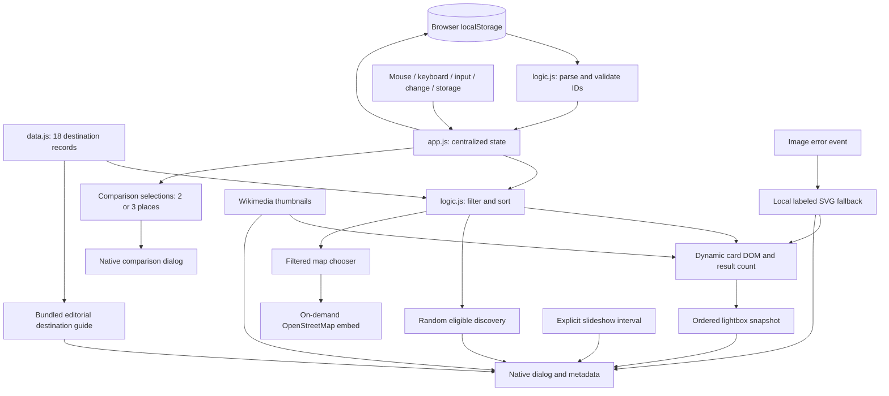

# ATLAS — Beyond the Ordinary
## 1. Abstract

ATLAS is a static, interactive photography gallery that helps users discover destinations through a curated visual collection. It addresses the limitations of passive image grids by combining search, categorical exploration, favorites, detailed place guides, map exploration, comparison, random discovery and an accessible image viewer with controlled slideshow playback. The implementation uses semantic HTML5, responsive CSS3 and vanilla JavaScript without a frontend framework or build pipeline. Eighteen destination records supply photography, editorial information and sourced map coordinates from a single data source. Mouse events, native keyboard activation, custom viewer shortcuts and timer lifecycle management demonstrate event-driven frontend development. A centralized state object coordinates selection, sorting and browser-local persistence. Testing combines dependency-free automated logic checks, verified remote sources and observed browser interactions. The project records unexecuted accessibility, failure-mode and cross-browser checks explicitly; it does not claim certified accessibility or measured performance targets.

## 2. Project Overview

### Introduction, background and motivation

Travel photography is well suited to an interactive interface: users recognize subjects visually, but need textual context and controls to navigate a larger collection. A photograph can be explored, filtered and saved, making the subject a useful setting for meaningful mouse and keyboard events. ATLAS presents an editorial alternative to a dense dashboard, using the required #030407 background, #1558C9 selected states and #D4FF24 accents. System sans-serif typography pairs with Georgia editorial headings, avoiding an external font dependency.

### Problem statement

A passive image grid offers little support for finding a destination, comparing related places, saving interests or browsing with only a keyboard. Adding independent controls without shared state can create incorrect counts, lost filters and inconsistent favorite icons. An image overlay can also trap or lose focus unless its lifecycle is designed carefully.

### Objectives and expected outcomes

The project implements a coherent static product with combined search/filter/sort behavior, a usable lightbox and persistent favorites. It demonstrates semantic markup, grid/flex layouts, responsive breakpoints, DOM construction, event delegation, state management, defensive storage parsing, and systematic tests. The expected outcome is a demonstrable local university project with reviewable source and evidence-based documentation.

### Target users and scope

Users include people exploring travel imagery, keyboard users, mobile users, and instructors reviewing frontend skills. The scope includes 18 curated destinations across Europe, Asia, Africa, North America and South America. No booking, uploads, account management or geographic routing is provided. Beach/coastal categories include island and bay destinations; regional labels describe the destination rather than asserting every image shows a literal beach.

### Features and functional requirements

The header links to real page sections, exposes saved places and search, and offers a collapsible phone menu. The hero leads into a dynamic gallery. Search matches destination, country, category and description with trimmed case-insensitive substring logic. Six categories combine with search, favorites-only and three sort modes. Large and compact desktop layouts share the same records. Empty states explain recovery. Hearts synchronize the header count, grid and lightbox and persist valid identifiers in localStorage.

The lightbox provides selected metadata, credit, index, bounded previous/next navigation, saving, Escape, arrow keys and F. It also includes detailed guides and an explicitly started slideshow with 3/5/8-second durations, pause/resume and P. Native dialog behavior makes background content inert. Visible sticky close controls, explicit Tab wrapping, scroll locking and focus restoration complete the lifecycle. Mouse enter/leave adds restrained feedback, while native buttons support Enter and Space. Collection actions select meaningful categories.

Every destination has an original editorial overview, three highlights and interests, cultural context, a general planning suggestion, source link and representative coordinates. An on-demand OpenStreetMap embed supports destination selection and nearby pan/zoom while respecting the gallery's filters. Two or three destinations can be compared by country/continent, landscape, highlights, interests, context and planning notes. Comparison choices survive filter changes but reset on reload. Random discovery uses the eligible edit and avoids an immediate repeat where possible.

### Non-functional requirements

The application is build-free and uses no runtime dependencies. Text and controls use semantic markup, labels and visible focus. Results are announced in a polite live region. Images have descriptive alternatives, stable ratios, lazy loading below the fold and asynchronous decoding. CSS respects reduced motion. Storage exceptions and malformed data recover without aborting the application. Remote photographs have a local labeled fallback. These practices support accessibility goals but do not constitute a complete WCAG audit.

## 3. Tech Stack and System Architecture

### Technology responsibilities

| Technology | Implemented responsibility |
| --- | --- |
| HTML5 | Landmarks, heading hierarchy, anchors, labels, native buttons/select, two modal dialogs and a titled on-demand map iframe |
| CSS3 | Required palette/tokens, typography, Grid/Flexbox, clamp sizes, aspect ratios, hover/focus/disabled states and media queries |
| Vanilla JavaScript | Central state, rendering, data selection, comparison/random/map helpers, slideshow interval cleanup, focus lifecycle and storage recovery |
| DOM APIs | Safe `createElement`, `textContent`, `append`, `replaceChildren`, dataset and attribute updates |
| localStorage | Device/browser-local favorite IDs, validated reads, caught writes and storage-event synchronization |
| External photography | Verified Commons thumbnails, source page, author and license metadata |
| OpenStreetMap | Remote interactive embed, selected representative pin, nearby pan/zoom and visible contributor/license attribution |
| Node/Python standard libraries | Runnable logic checks and optional remote source verification; neither is shipped to browsers |

### Architecture and data flow

The page loads three ordered classic scripts with `defer`. `data.js` supplies records. `logic.js` exposes small pure functions for the browser and CommonJS tests. `app.js` is enclosed in an immediately invoked function to avoid leaking application variables. It reads and validates favorites, constructs category buttons and renders the selected cards.

State contains `activeCategory`, `searchQuery`, `sortMode`, a favorites Set, `favoritesOnly`, `currentPhotoId`, `currentLayout`, `comparisonIds`, `mapPhotoId`, `lastSurpriseId`, and `guideOpen`. The slideshow interval and modal triggers are separate lifecycle variables. Input changes update only their corresponding selection. `selectPhotos` applies all restrictions and sorts a new array, leaving the original data intact. `renderGallery` replaces cards and updates controls, comparison chips and the open map's eligible choices. The map's iframe URL is only replaced if its selected coordinates change, preserving pan/zoom across unrelated state changes. Rebuilding 18 cards is intentionally simple; a much larger gallery could require incremental rendering or virtualization.

### Components and events

The components are page navigation, hero, gallery controls/discovery tools, generated cards, map panel, comparison selection tray/dialog, lower category collections, footer, and the shared photo/guide dialog. Delegated gallery clicks distinguish comparison, guide, favorite and photograph targets. All are separate native buttons; no nested button or unnecessary `stopPropagation` is needed. Category and comparison-chip clicks are also delegated. Individual generated cards receive one `mouseenter` and one `mouseleave` listener. Removed nodes and their listeners are garbage collected; no new document listener is added per rendering/opening.

Search uses `input`; sort, map selection and slide duration use `change`; navigation uses links and `hashchange`; favorites from another tab use `storage`. The single document `keydown` listener handles Ctrl/Cmd+K, viewer arrows/F/P/Tab, comparison Tab and mobile-menu Escape. Focus trapping includes visible enabled buttons, links and selects and excludes collapsed guide controls. Editable targets and modifier checks protect ordinary input. Enter/Space use native buttons; modal Escape uses native dialog cancel behavior. `visibilitychange` pauses a playing slideshow when the tab becomes hidden. Default behavior is prevented only for consumed custom keys.

### Lightbox lifecycle and synchronization

Opening saves the trigger element, snapshots the current filtered/sorted records, fills content, calls `showModal`, locks body scrolling and focuses Close. Navigation checks actual adjacent records and disables boundary buttons. Saving updates the gallery immediately but preserves the viewer snapshot for predictable navigation. Background filter controls are inert while the modal is open. Closing unlocks scrolling and returns focus to the original button, its replacement after a render, or My collection if the card no longer qualifies. The snapshot policy also handles current-photo removal after a favorites or storage update.

Comparison uses a separate native dialog. Its guide action first closes comparison, then opens the viewer from the comparison close event, avoiding stacked modal races. That viewer snapshots the selected comparison order even when gallery filters hide those places. Its Close action returns focus to Compare places. Clearing comparison with an empty eligible gallery returns focus to search rather than a disabled discovery control.

`pickRandomPhoto` removes the last surprise from the eligible set when alternatives exist and returns null for an empty set. `toggleComparison` returns a new selection array or the existing array when the three-place limit rejects an addition. `mapLinks` validates finite coordinates and constructs an encoded OpenStreetMap embed/larger-map pair. Tests cover these pure boundaries and actual UI behavior.

Playback is opt-in and requires at least two snapshot records. `playSlideshow` clears any previous interval before starting one; timed navigation wraps modulo the snapshot length. `pauseSlideshow` clears the interval and updates button/status state. Manual navigation, guide expansion, image failure, viewer close and backgrounding pause playback. Duration changes restart an active interval; simply returning to the tab does not restart it. Opening any new viewer begins paused, preventing accumulated intervals.

### Images, attribution and failures

`tests/verify_sources.py` queries Wikipedia lead-image metadata and Commons image information, records author/license/source links and checks exact thumbnail URLs using HEAD. Scenic alternatives were selected where an article's first image was a map, historical portrait, or missing. The committed data needs no runtime guide/source metadata API or credentials; images and the optional map load remotely. Eighteen image endpoints returned HTTP 200 during initial verification. The hero reuses the credited Dolomites image.

Images are remote Commons thumbnails; no photographs are redistributed in the repository. Gallery crops use `object-fit: cover`; the dialog uses `contain`. A document capture listener handles non-bubbling image errors, removes responsive sources, assigns a local SVG and guards against fallback loops. The viewer shows a loading message until successful load and a useful failure message otherwise. Broken remote photography does not prevent metadata, search or saving. All current images use Commons; local fallback artwork keeps the application usable if that service is unavailable.

`tests/enrich_guides.py` consults geographic source introductions and coordinates through a batched Wikipedia query, preserves existing image metadata, and writes guide fields into the same data array. Guides use original editorial summaries with linked sources. The image refresh script preserves those fields. [Destination sources](DESTINATION_SOURCES.md) lists all 18 geographic references, representative pins and the consulted OpenStreetMap documentation. The map iframe loads only when requested; a permanent larger-map link and explanation remain available if the remote embed is blocked.

## 4. Limitations

Remote photography requires connectivity and can change or be rate-limited. Thumbnail crops and 1280px source sizes are suitable for a demonstration but are not a full responsive image optimization pipeline. There is no offline photo cache. The gallery replaces its small card set on each query; it is not designed for tens of thousands of entries.

Browser storage is local to an origin and device, may be cleared, and may throw in restrictive environments. Failed writes keep favorites for the current visit only. There is no backend database or authentication. Search is literal substring matching without typo correction, transliteration or semantic ranking. Layout/search/sort settings reset on reload.

Native dialog and focus behavior can vary by browser. Chromium was exercised through the available in-app browser; full Safari/Firefox, assistive-technology, OS reduced-motion and forced failure tests remain open as listed in the results. Computed contrast checks cover the principal solid-color text pairs, not every photograph/overlay combination. No performance score, exhaustive accessibility conformance or real-device touch claim is made.

The map requires OpenStreetMap connectivity and shows a selected representative point rather than all markers simultaneously or a geographic routing engine. Embedded content is controlled by its external provider. Guide tips are general suggestions; no live price, entry schedule, weather, visa or travel advisory data is claimed. Comparison is qualitative, not a ranking or cost estimator, and is session-only. Background-tab pause and forced slideshow image-failure cleanup are implemented but still require dedicated environmental tests, as recorded in the test report.

Accounts, personal travel journals, shareable destination links, swipe navigation, downloads and uploads are outside the requested scope. These exclusions are separate from operational limitations.

## 5. Future Scope

Future improvements could add a backend and authenticated accounts for cloud-synchronized collections, an all-destination marker layer with route exploration, more advanced country/continent/category filters, fuzzy and multilingual search, and a CMS for destination curation. The implemented map, guides, comparison, random discovery and slideshow are current features, not future work. AI-assisted recommendations could be explored with clear data/privacy boundaries and suitable evaluation; no AI recommendations are currently implemented.

An image pipeline could generate smaller responsive derivatives, cache approved assets and add PWA offline support. Downloadable collections would require reviewing the exact licenses and attribution obligations of all included files. Internationalization could cover interface labels and destination descriptions. Automated cross-browser and visual regression suites, screen-reader testing and performance measurements would strengthen validation as the project grows.

## 6. Conclusion

ATLAS implements a static photography and destination-discovery experience using HTML, CSS and JavaScript. Its single data source, pure selection/random/comparison/map functions and centralized state make the interactions understandable during a code walkthrough. Mouse events and keyboard behavior serve browsing, saving, detailed reading, map selection, comparison and explicitly controlled slideshow tasks. Responsive layouts, semantic controls, modal transitions, timer cleanup, descriptive text and reduced-motion rules address important usability needs.

Testing uses runnable Node checks for logic/data/structure and observed browser checks for interaction and layout behavior. The executed results and remaining coverage are recorded separately. The project demonstrates frontend composition, DOM programming, persistence validation, error handling and honest test reporting without introducing a backend or build framework.

## 7. References

### Technical references consulted

- MDN Web Docs. [The dialog HTML element](https://developer.mozilla.org/en-US/docs/Web/HTML/Reference/Elements/dialog). Native showModal, modal behavior and close lifecycle.
- MDN Web Docs. [Window: localStorage property](https://developer.mozilla.org/en-US/docs/Web/API/Window/localStorage). Browser persistence and exceptions.
- MDN Web Docs. [EventTarget: addEventListener()](https://developer.mozilla.org/en-US/docs/Web/API/EventTarget/addEventListener). DOM event registration and listener behavior.
- W3C WAI. [Dialog (Modal) Pattern](https://www.w3.org/WAI/ARIA/apg/patterns/dialog-modal/). Focus containment, return focus and keyboard expectations.
- W3C. [Web Content Accessibility Guidelines (WCAG) 2.2](https://www.w3.org/TR/WCAG22/). Keyboard access, focus, alternatives and contrast guidance.
- Node.js. [Test runner](https://nodejs.org/api/test.html). Built-in `node:test` execution.

### Image sources and reuse

- Wikimedia Commons. [Reusing content outside Wikimedia](https://commons.wikimedia.org/wiki/Commons:Reusing_content_outside_Wikimedia). Per-file attribution and license review.
- Individual Commons file descriptions and license links are listed in [Image credits](IMAGE_CREDITS.md), generated from consulted live image metadata. Those records identify the actual photographs in this implementation; no creator ownership is claimed by ATLAS.
- OpenStreetMap. [Export documentation](https://wiki.openstreetmap.org/wiki/Export) and [Copyright and license](https://www.openstreetmap.org/copyright). Consulted for the on-demand embed and visible contributor/ODbL attribution.
- Geographic introductions and coordinate sources for all 18 guides are recorded in [Destination guide sources](DESTINATION_SOURCES.md). Guide prose is editorial; live travel conditions are not part of the dataset.

References consulted on 29 October 2026. No testing library was added; the in-app browser's supported automation surface was used for observed browser checks.
